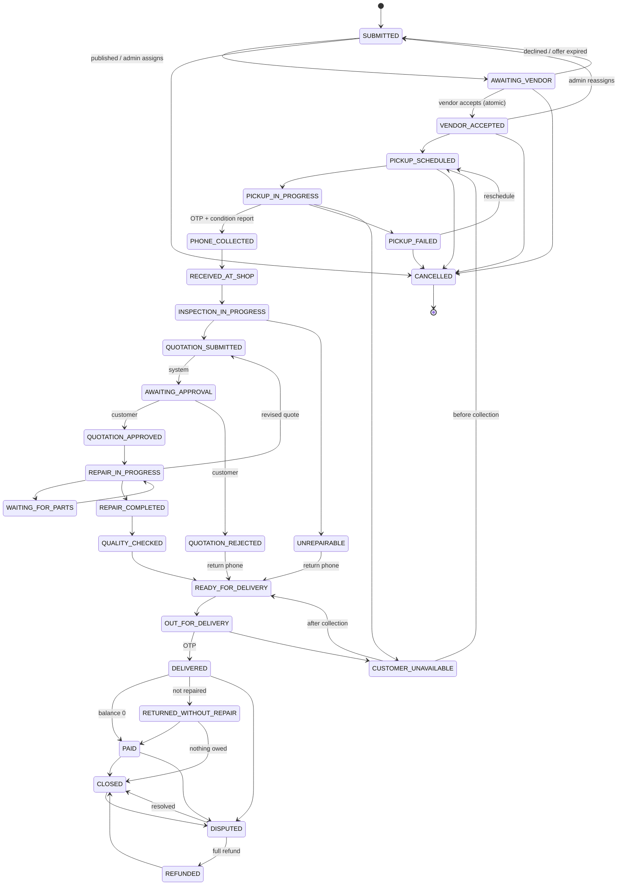

# Architecture

## Why the backend runs in the browser

This is a portfolio build deployed as a static site, so there is no database server.
Instead, `src/app/core/backend.ts` is written as the server would be. It is a plain
TypeScript class with no Angular imports, and:

- takes only a **session token** and plain input from callers, and resolves the user itself;
- **re-reads the database at the start of every call** and commits all of its writes or none (`tx()`);
- **authorises every call**, both by role/permission and per record (e.g. "is this your job?");
- **validates every input** with Zod schemas (`schemas.ts`);
- only changes job status through the **state machine** (`workflow.ts`), writing immutable history;
- returns copies, never live references (`Api` structured-clones every result).

`Api` (`core/api.ts`) is the only thing the UI talks to. It loads the backend as a lazy
chunk, adds network-like latency, and bumps a `revision` signal after writes so pages
re-fetch. A `storage` event listener keeps two open tabs in sync.

Porting to a real server means moving `backend.ts` behind HTTP routes (Next.js route
handlers or NestJS) and replacing `Db`/`DbStorage` with Prisma. `prisma/schema.prisma`
is that target schema. The UI does not change, because it already calls an async API with a token.

```
┌──────────── Angular UI (standalone, signals, zoneless) ────────────┐
│ features/public   customer   vendor   jobs (shared)   admin        │
│        │ resource() + api.query / api.mutate                       │
├────────▼───────────────────────────────────────────────────────────┤
│ core/api.ts      token, latency, revision signal, cross-tab sync   │
├────────▼──────── lazy chunk ───────────────────────────────────────┤
│ core/backend.ts  auth · RBAC · record access · Zod · transactions  │
│ core/workflow.ts state machine     core/finance.ts money rules     │
│ core/crypto.ts   SHA-256, salted/stretched hashes, OTPs            │
├────────▼───────────────────────────────────────────────────────────┤
│ core/db.ts       Db document ⇄ localStorage (tests: MemoryDb)      │
└────────────────────────────────────────────────────────────────────┘
```

## Data model and relationships

All tables live in `core/db.ts` (`Db`) and types in `core/models.ts`.

```mermaid
erDiagram
  User ||--o| CustomerProfile : "role CUSTOMER"
  User ||--o| VendorProfile : "role VENDOR"
  User ||--o{ Session : has
  VendorProfile }o--o{ ServiceArea : serves
  VendorProfile }o--o{ RepairCategory : specialises
  VendorProfile }o--o{ PhoneBrand : supports
  PhoneBrand ||--o{ PhoneModel : has
  User ||--o{ RepairJob : "requests (customer)"
  User ||--o{ RepairJob : "repairs (vendor)"
  RepairJob }o--|| PhoneModel : device
  RepairJob }o--|| RepairCategory : problem
  RepairJob ||--o{ StatusHistory : "immutable log"
  RepairJob ||--o{ RepairAssignment : "offers / claims"
  RepairJob ||--o{ PickupDeliveryTask : visits
  RepairJob ||--o{ DeviceConditionReport : condition
  RepairJob ||--o{ RepairInspection : findings
  RepairJob ||--o{ RepairQuotation : "versions"
  RepairJob ||--o{ RepairPartUsage : parts
  RepairJob ||--o{ RepairWorkLog : notes
  RepairJob ||--o{ PaymentTransaction : ledger
  RepairJob ||--o| Invoice : receipt
  RepairJob ||--o| Warranty : warranty
  RepairJob ||--o| Review : "one per job"
  RepairJob ||--o{ Complaint : disputes
  User ||--o{ VendorSettlement : "vendor payouts"
  User ||--o{ Notification : inbox
  Notification ||--o{ DeliveryLog : "email/SMS attempts"
  User ||--o{ UploadedFile : owns
  User ||--o{ AuditLog : actor
```



Constraints the backend enforces inside transactions:

| Rule | Where |
|---|---|
| Unique email and phone among non-deleted users | `createUser` |
| At most one `ACCEPTED` assignment per job; first accept wins | `acceptJob` |
| One review per job; only by its customer; only after delivery | `addReview` |
| Unique `idempotencyKey` on ledger entries (retries/webhooks) | `recordPayment`, `gatewayWebhook`, `issueRefund` |
| Ledger entries are append-only; only `PENDING_VERIFICATION → CONFIRMED` may change | `verifyTransfer` |
| Commission terms frozen on each quotation | `submitQuotation` |
| Refunds ≤ net paid; settlements ≤ open balance and in its direction | `issueRefund`, `createSettlement` |
| Optimistic concurrency: `job.version` bumped on every write; stale writes rejected | `checkVersion` |

Sensitive data:

- passwords are salted and stretched hashes, and session tokens are stored hashed;
- OTPs are salted hashes with an expiry and an attempt limit;
- IMEIs are masked for everyone except the job's vendor and admins;
- IBANs are masked in admin lists;
- marketplace previews hide the customer's name, phone, street address and photos until a vendor accepts;
- device passcodes are never collected, and the UI warns couriers not to ask for them.

## Job lifecycle

`workflow.ts` holds the transition table: for each status, the next statuses, who may
trigger each one, and whether it is "plain" (a button) or needs its own endpoint (OTP,
quotation, payment...). Every change writes a `StatusHistoryEntry` with from/to, actor,
time, note and optional evidence files.



## Money rules (`finance.ts`)

- **Billable quotation**: the latest approved version. If the job isn't repaired (rejected or unrepairable), only the consented diagnostic fee is billed. Rejecting a revised quote supersedes the earlier approval too.
- **Totals** are integer rupees: `(sum of lines − discount) + round(tax)`.
- **Commission** = `round(base × pct) + fixed`, capped at the base. Base = total − tax − refunds. Terms come from the quotation, not the current settings.
- **Recognition**: commission and vendor earnings count once the job is in a final money state (`PAID`, `CLOSED`, `REFUNDED`, `RETURNED_WITHOUT_REPAIR`).
- **Vendor balance** = Σ earnings on final jobs − Σ cash the vendor collected − Σ settlements. Positive means the platform owes the vendor; negative means the vendor owes commission.
- Reports keep **gross repair value, collected payments, refunds, outstanding, commission (platform revenue) and vendor earnings** as separate figures, never interchangeable.

## Reporting

`reports.ts` computes everything from the admin read model (`reportData`, with addresses
stripped). Dates are bucketed in **Asia/Karachi** with inclusive day boundaries. Job counts
use the creation date, ledger figures use the entry date, and commission uses the date the
job became final. The UI states these definitions next to the numbers. CSV export
neutralises spreadsheet formulas and is UTF-8 with a BOM.

## Assumptions and business rules

- **Assignment**: the mode is configurable. First-accept publishes to eligible vendors (approved, available, covering the area, brand and category). Admin-assign offers a job to one vendor with a timeout (default 4h). When the timeout lapses, the job returns to the queue on the next request.
- **Cancellation**: customers can cancel until the phone is collected (configurable). Staff with `jobs.cancel` can cancel before collection. After collection, the phone must be returned through the delivery flow.
- **Diagnostic fee**: only charged if the customer agreed to it on the request.
- **Delivery fee**: billed through the quotation's "Pickup and delivery" line. The task fee is informational.
- **Who holds cash**: a vendor recording a payment holds the cash, while a platform agent's COD or a verified bank transfer is held by the platform. This drives settlements.
- **Disputes**: customers can raise them after delivery. A full refund moves the job to `REFUNDED`; otherwise staff resolve and close it with a note.
- **Reviews**: one per job, only after the phone is back. Moderation hides a review (with a policy reason) but never edits it.
- **Account deletion**: customers' personal data is anonymised and financial records are kept.

## Implementation checklist

| Phase | Status |
|---|---|
| 1. Requirements, schema, roles, permissions, transitions | ✅ this document, `models.ts`, `workflow.ts`, `prisma/schema.prisma` |
| 2. Auth, RBAC, profiles, layouts, seed data | ✅ sessions, lockout, rate limits, phone verification, role guards, demo seed |
| 3. Requests, vendor registration and approval, marketplace, lifecycle | ✅ both assignment modes, race-safe accept, status history |
| 4. Inspection, quotations (versions), parts, pickup and delivery, notifications | ✅ OTP handovers, condition reports, evidence photos, in-app notifications and channel log |
| 5. Payments, invoices, commissions, refunds, settlements | ✅ ledger, idempotency, transfer verification, webhook handler, settlements |
| 6. Dashboards, reports, exports, disputes, audit log | ✅ KPIs, operational and financial reports, CSV, print, complaints, moderation, audit |
| 7. Tests and docs | ✅ 85 unit and integration tests, Playwright lifecycle run, docs |
